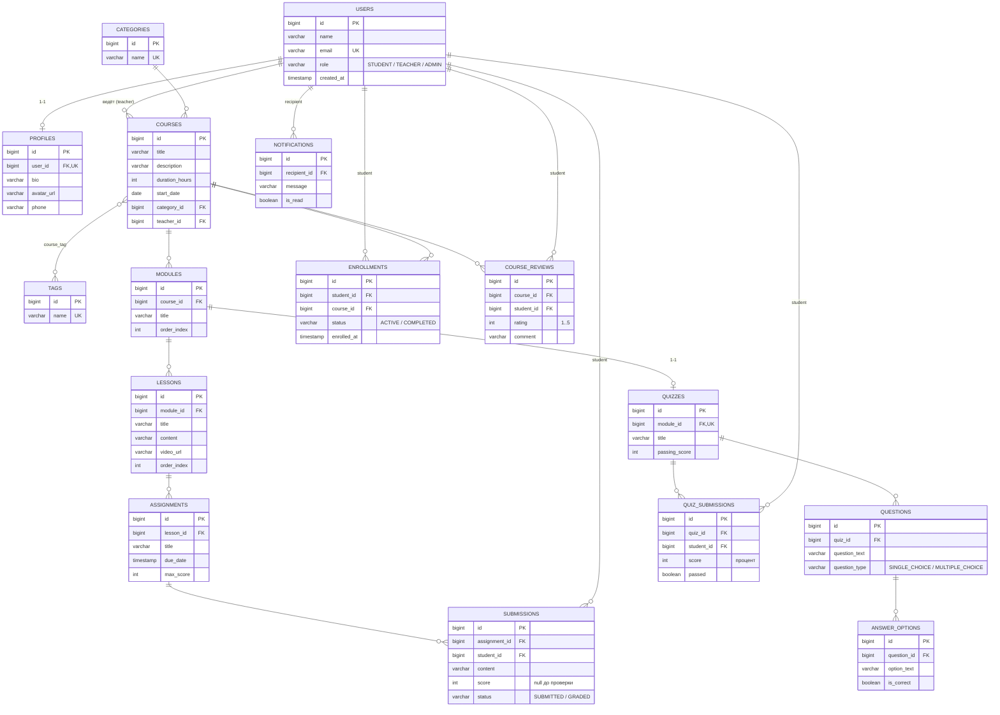

# Модель данных

16 сущностей + одна служебная таблица `course_tag` (ManyToMany без отдельной сущности).

Схему можно вставить в [Mermaid Live Editor](https://mermaid.live), GitHub тоже рисует её прямо в этом файле.

## Типы связей

| Связь | Где | Как сделано |
|---|---|---|
| 1-1 | User — Profile | `Profile.user` владеет (`user_id unique`), в `User` — `mappedBy` |
| 1-1 | CourseModule — Quiz | `Quiz.module` владеет (`module_id unique`), один тест на модуль |
| 1-M | Course → Module → Lesson → Assignment → Submission | `@OneToMany(mappedBy)` + `@ManyToOne(fetch = LAZY)` |
| 1-M | Quiz → Question → AnswerOption | то же самое |
| M-M через сущность | User — Course (Enrollment), User — Assignment (Submission), User — Quiz (QuizSubmission), User — Course (CourseReview) | отдельная сущность, потому что нужны свои поля (статус, дата, оценка) |
| M-M без сущности | Course — Tag | `@ManyToMany` + `@JoinTable(name = "course_tag")`, владелец — Course |

Все `@ManyToOne` и `@OneToOne` явно помечены `fetch = FetchType.LAZY` (по умолчанию у них EAGER).
Коллекции `@OneToMany` / `@ManyToMany` ленивые по умолчанию.

## Уникальность

- `users.email`, `categories.name`, `tags.name`
- `enrollments (student_id, course_id)` — нельзя записаться дважды
- `submissions (student_id, assignment_id)` — одно решение на задание
- `course_reviews (student_id, course_id)` — один отзыв на курс
- `quizzes.module_id` — один тест на модуль

Проверки дублируются в сервисах (понятная ошибка 409), а ограничения в БД — страховка на случай гонки.

## Каскады и удаление

- **Курс** владеет своей структурой: `CascadeType.ALL + orphanRemoval` на модули, уроки, задания, решения, тест с вопросами.
  Но курс, на который записаны студенты, удалить нельзя — сервис вернёт 409. Решила так, чтобы случайно не потерять прогресс студентов.
- **Теги** не удаляются вместе с курсом (на `@ManyToMany` нет `REMOVE`), удаляются только строки в `course_tag`.
- **Пользователь**: при удалении каскадом удаляются профиль, записи на курсы, решения, результаты тестов, отзывы и уведомления.
  Преподавателя, у которого есть курсы, удалить нельзя (409).
- **Категория** с курсами не удаляется (409).
